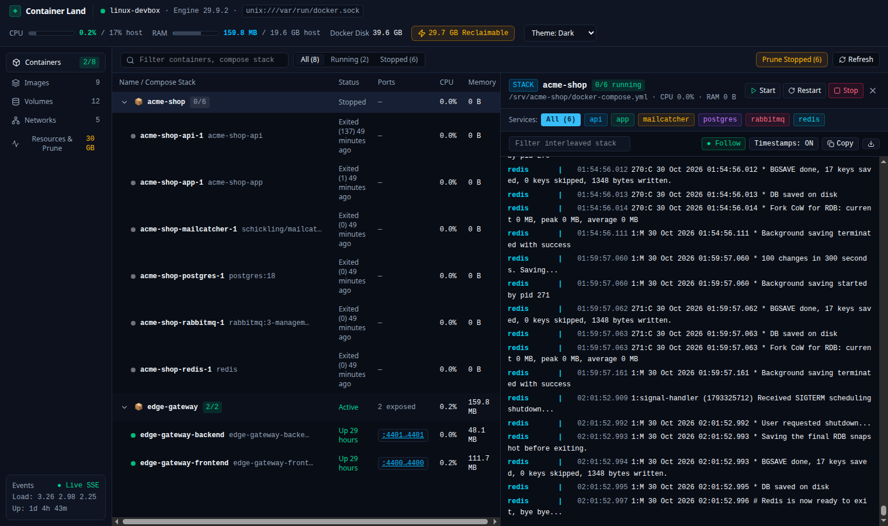
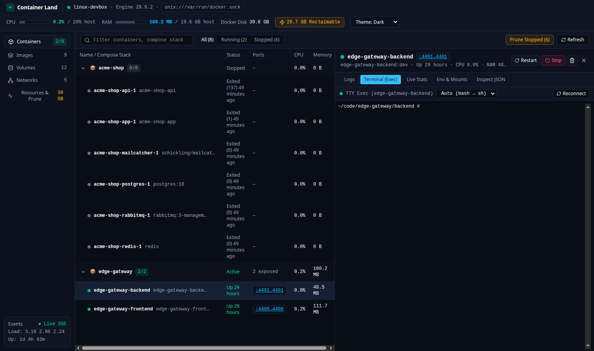
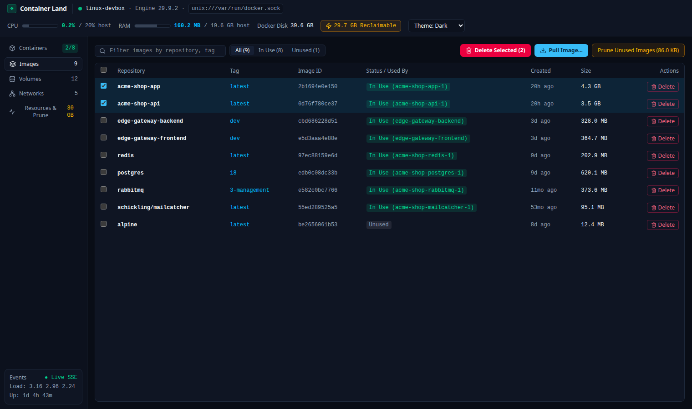
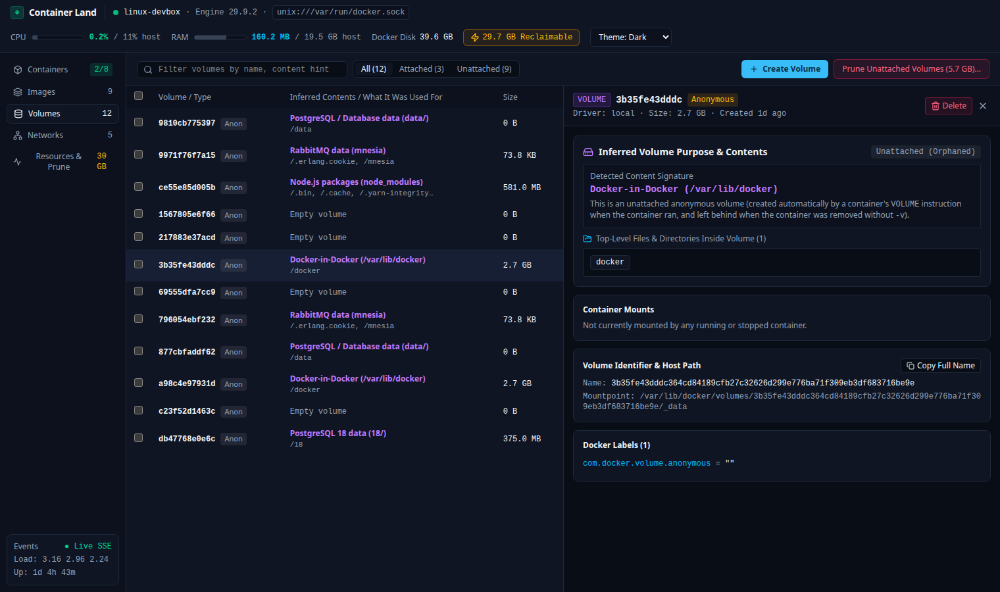
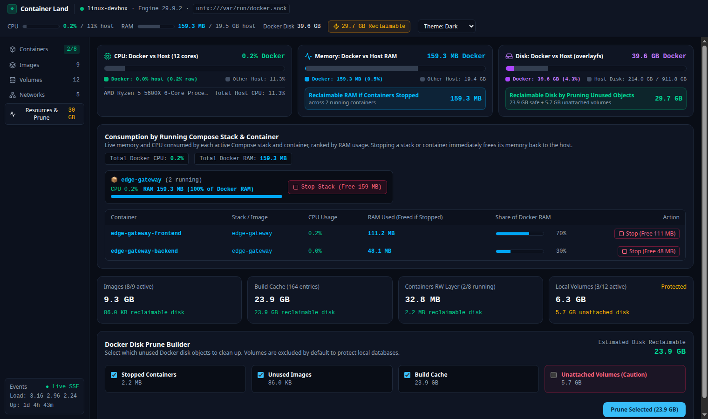

# Container Land

If you run Docker natively on Linux, you already get the best part of the deal: containers run directly on your kernel with zero virtual machine tax. What you usually lose is the nice visual dashboard from Docker Desktop when you just want to tail interleaved logs across a six-service Compose stack, pop a shell into a container, or figure out why `/var/lib/docker` quietly ate 40 GB of your SSD.

Most alternatives either want you to run a bloated VM anyway (the horror!) or ask you to spin up a management container with a database just to look at your other containers.

I built **Container Land** to fix that. It is a single, self-contained Go binary with an embedded web UI that talks directly to your local Docker socket (`/var/run/docker.sock`, Rootless Docker, or macOS runtimes) and runs quietly in the background on `http://127.0.0.1:8485`.



## Supported Platforms

Container Land ships pre-built, zero-dependency static binaries for:

- **Linux (`amd64` and `arm64`)**: First-class native support (reads host telemetry directly from `/proc` and `statfs`, and manages a user `systemd` service).
- **Windows (via WSL2)**: Run the `linux-amd64` (or `linux-arm64`) binary inside your WSL2 distribution where Docker Engine lives. WSL2 automatically forwards `http://127.0.0.1:8485` straight to your Windows browser.
- **macOS (`arm64` Apple Silicon and `amd64` Intel)**: Works out of the box with OrbStack, Colima, Rancher Desktop, or Docker Desktop. Auto-discovers `~/.orbstack/run/docker.sock`, `~/.colima/default/docker.sock`, and `~/.docker/run/docker.sock`, and can install a user `LaunchAgent` so it starts automatically on login.

## What it does (and why)

### 1. Compose stacks and interleaved logs in one split view

When you are working on a local project, you rarely care about a single container in isolation. You care about the stack. Container Land groups your containers automatically by their `com.docker.compose.project` label alongside any standalone containers.

Clicking any Compose stack opens the slide-over inspector on the right and streams live, colour-coded, interleaved logs from every service in that stack at once. You can filter down to a single service pill (`api`, `postgres`, `redis`), search in real time, toggle timestamps, or copy the lot to your clipboard in one click. Starting, stopping, or restarting a stack gives you immediate progress feedback so you are never left guessing whether Docker heard you.

### 2. Instant in-browser `exec` terminal (`xterm.js`)

Sometimes you just need to poke around inside a running container without opening another terminal tab and typing `docker exec -it <some-long-container-name> /bin/sh`.

Click **Exec** on any running container (or switch to the **Terminal (Exec)** tab in the right drawer) to get a full interactive WebSocket TTY session powered by `xterm.js`. It automatically falls back from `bash` to `sh` on minimal Alpine images and resizes cleanly with the drawer.



### 3. Image management with multi-select and live pull streaming

The **Images** view shows every local image, whether it is currently in use (and by which containers), its age, and its size.

- **Pull with live layer progress**: Click **Pull Image...**, type a tag like `redis:7-alpine` or `postgres:18`, and hit `Enter` to watch the layer-by-layer download stream live.
- **Bulk cleanup**: Tick the checkboxes next to old build artefacts and delete them in a single batch, or hit **Prune Unused Images** to clear dangling layers in one go.



### 4. Volume inspection that actually tells you what anonymous volumes are

Anyone who has used Docker for more than a week has stared at a list of unattached volumes named `3b35fe43dddc364cd84189cfb27c32626d299e776ba71f309eb3df683716be9e` and wondered: *"Is that my local Postgres database from Tuesday, or 2 GB of dead `node_modules`?"*

Container Land solves this by performing a fast, read-only inspection of volume directories and matching their top-level file signatures. Even when an anonymous volume is completely unattached, the **Volumes** table tells you what is inside (`PostgreSQL 18 data (18/)`, `RabbitMQ data (mnesia)`, `Node.js packages (node_modules)`, `Docker-in-Docker (/var/lib/docker)`, or `Empty volume`). Clicking any volume opens the **Volume Inspector** drawer so you can see the exact top-level files and directories before you decide to delete it.



### 5. Docker vs Host resource telemetry and safe pruning

System monitors like `htop` or `btop` already show you what your machine is doing overall. What you actually want to know in a container manager is how much of your machine **Docker** is eating, which specific containers are responsible, and what you can get back if you stop or prune them.



The **Resources & Prune** page (and the persistent top telemetry bar) uses dual-colour stacked bars to separate **Docker's consumption** from the **rest of your host system**:

- **CPU & RAM (Docker vs Host)**: See the exact CPU percentage and live RAM consumed by running containers versus other host processes, plus a clear callout showing how much **RAM you will immediately reclaim** if you stop your running containers.
- **Consumption by Running Compose Stack & Container**: A live leaderboard ranking your active Compose stacks and containers by memory footprint, complete with one-click **Stop (Free X MB)** buttons when a runaway service needs to be put to bed.
- **Safe Disk Prune Builder**: Breaks down `/system/df` across Images, Build Cache, Stopped Containers, and Local Volumes. Named and anonymous volumes are **excluded by default** (protected behind a separate warning checkbox and confirmation modal) so a routine disk cleanup never nukes your local database state.

## Installation & Setup Guide

### Option 1: Download Pre-built Binary (Quickest, no Go or Node required)

Every tagged release publishes standalone binaries on the [GitHub Releases](https://github.com/CodeBrewStudio/container-land/releases) page. The binary includes a built-in `--install-service` flag so you do not even need to clone the repository to set up the background service.

#### Linux (x86_64 / `amd64`) & Windows WSL2

```bash
mkdir -p ~/.local/bin
curl -fsSL https://github.com/CodeBrewStudio/container-land/releases/latest/download/container-land-linux-amd64 \
  -o ~/.local/bin/container-land
chmod +x ~/.local/bin/container-land

# Install and start the background user systemd service on http://127.0.0.1:8485
~/.local/bin/container-land --install-service
```

*(For ARM64 Linux machines like Raspberry Pi or ARM cloud boxes, replace `container-land-linux-amd64` with `container-land-linux-arm64`.)*

#### macOS (Apple Silicon `arm64` / Intel `amd64`)

```bash
mkdir -p ~/.local/bin
ARCH=$(uname -m | sed 's/x86_64/amd64/')
curl -fsSL "https://github.com/CodeBrewStudio/container-land/releases/latest/download/container-land-darwin-${ARCH}" \
  -o ~/.local/bin/container-land
chmod +x ~/.local/bin/container-land

# Install and start the background macOS LaunchAgent on http://127.0.0.1:8485
~/.local/bin/container-land --install-service
```

Once installed, open [http://127.0.0.1:8485](http://127.0.0.1:8485) in your browser. If you prefer not to run a background service, skip `--install-service` and just run `~/.local/bin/container-land --open` whenever you want it.

### Option 2: Build from Source

If you want to build from source (requires **Go 1.23+** and **Node.js 20+**):

```bash
git clone https://github.com/CodeBrewStudio/container-land.git
cd container-land

# Build the frontend and compile ./bin/container-land
make build

# Run directly and open in browser
./bin/container-land --open

# Or install binary to ~/.local/bin and enable the user systemd service
make install-service
```

## How to Use It & Permissions Required

### Does Container Land need `root` or `sudo`?

**No.** Container Land runs as your normal desktop user on an unprivileged loopback port (`127.0.0.1:8485`), and its background service runs under your user session (`systemctl --user` on Linux, or `~/Library/LaunchAgents` on macOS).

### Docker Socket Permissions

The only permission Container Land needs is read/write access to your local Docker Engine socket (the exact same permission required to run `docker ps` in your terminal without `sudo`):

1. **Standard Linux Docker (`/var/run/docker.sock`)**:
   Make sure your Linux user is in the `docker` group:
   ```bash
   sudo usermod -aG docker $USER
   newgrp docker
   ```
   *(If you just added yourself to the `docker` group and already have the user `systemd` service running, restart it with `systemctl --user restart container-land.service`.)*
2. **Rootless Docker on Linux (`$XDG_RUNTIME_DIR/docker.sock`)**:
   Works out of the box with zero extra groups or permissions because the socket is owned by your user.
3. **macOS (OrbStack, Colima, Docker Desktop)**:
   Works out of the box because the socket in `~/.orbstack/run/docker.sock`, `~/.colima/default/docker.sock`, or `~/.docker/run/docker.sock` is already owned by your macOS user.

### Managing the Background Service

```bash
# Linux: check status or tail logs
systemctl --user status container-land.service
journalctl --user -u container-land.service -f

# Stop and remove the background service (Linux or macOS)
~/.local/bin/container-land --uninstall-service
```

## Configuration (CLI Flags & Environment Variables)

Container Land auto-discovers your Docker socket in the following priority order:
1. `--socket` CLI flag
2. `DOCKER_HOST` environment variable
3. `$XDG_RUNTIME_DIR/docker.sock` (Rootless Docker on Linux)
4. `/var/run/docker.sock` (Standard Linux Docker Engine)
5. `~/.docker/run/docker.sock`, `~/.orbstack/run/docker.sock`, `~/.colima/default/docker.sock`, `~/.rd/docker.sock` (macOS & user-scoped runtimes)

| CLI Flag | Environment Variable | Default | Description |
|---|---|---|---|
| `--addr` | `CONTAINER_LAND_ADDR` | `127.0.0.1:8485` | HTTP listen address and port |
| `--socket` | `DOCKER_HOST` | Auto-discovered | Docker socket path (`unix:///var/run/docker.sock` or `tcp://...`) |
| `--open` | None | `false` | Automatically open the web UI in your default browser on startup |
| `--install-service` | None | `false` | Copy binary to `~/.local/bin/container-land` and enable user `systemd` service (Linux) or `LaunchAgent` (macOS) |
| `--uninstall-service` | None | `false` | Stop and remove the background user service |
| `--version` | None | None | Print the binary version and platform and exit |

## Development, CI & Releases

| Path | Purpose |
|---|---|
| `cmd/container-land/` | CLI entry point, service installer, and graceful shutdown |
| `internal/docker/` | Unix/TCP Docker Engine client, 8-byte stream demultiplexer, Compose grouper, volume content inspector, and TTY `exec` hijacker |
| `internal/host/` | Linux `/proc` (`stat`, `meminfo`, `loadavg`, `uptime`, `hwmon`) and `statfs` reader |
| `internal/server/` | HTTP API, SSE streams (daemon events, container logs, Compose logs, live stats), WebSocket `exec` bridge, and embedded SPA |
| `web/` | React 19 + TypeScript + Tailwind CSS + `xterm.js` frontend |
| `.github/workflows/ci.yml` | Runs Vitest, TypeScript, Vite build, `go vet`, `go test -race`, and cross-compile checks on every PR and push |
| `.github/workflows/release.yml` | Builds `linux/amd64`, `linux/arm64`, `darwin/arm64`, and `darwin/amd64` binaries + `checksums.txt` and publishes a GitHub Release whenever a `v*` tag is pushed |

To run all checks locally:

```bash
make test
```

To cut a new release once pushed to GitHub:

```bash
git tag v1.0.0
git push origin v1.0.0
```

## Security Notes

Container Land communicates directly with your local Docker Engine socket, which means anyone who can reach its HTTP port has the same privileges as your local `docker` CLI user. For that reason, Container Land binds strictly to loopback (`127.0.0.1:8485`) by default. Do not bind `--addr 0.0.0.0:8485` on an untrusted network unless you place it behind an authenticated reverse proxy or Tailscale ACL.

## Licence

Released under the [MIT Licence](./LICENSE). If you run into a bug or have an idea that would make daily Docker life better, issues and pull requests are very welcome.
